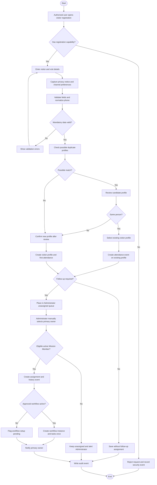
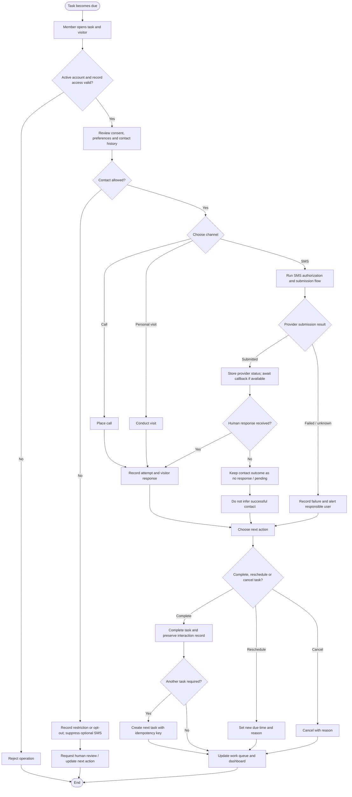
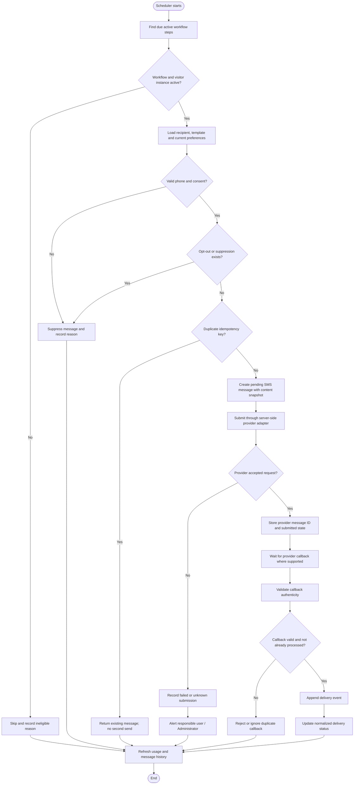
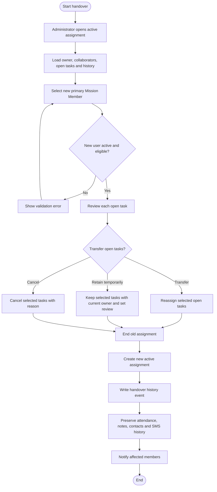
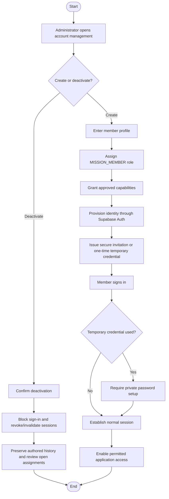

# ChurchConnect — Use-Case and Activity Models

**Version:** 1.0  
**Date:** 7 November 2026  
**Status:** Draft for design review  
**Requirements baseline:** ChurchConnect SRS v1.0  
**Scope:** Single church; exactly two application roles

## 1. Purpose

This document translates the SRS into actor-oriented use cases and workflow activity models. It is intended to confirm who may initiate each function, what conditions must be satisfied, and how the application responds to normal and exceptional events.

The models retain the approved role decision: the only application roles are **Church Administrator** and **Mission Member**. Welcome/registration is a duty enabled through an Administrator-granted capability on a Mission Member account. External systems and visitors are actors, not additional application roles.

## 2. Actors

| Actor | Type | Responsibilities / interaction |
|---|---|---|
| **Church Administrator** | Primary system actor | Provisions accounts, grants capabilities, registers/maintains visitor records, assigns primary owners, controls workflows/SMS templates/settings, handles escalations and views team-wide reports. |
| **Mission Member** | Primary system actor | Works with assigned/shared visitors, records visits and follow-up, creates permitted tasks, communicates through permitted channels, adds internal notes and requests handovers. |
| **Visitor** | External human actor | Provides personal details and communication preferences, attends services, receives follow-up and may respond or request support. No application login is assumed. |
| **SMS Gateway** | External system actor | Accepts outbound SMS requests and may send delivery-status callbacks. It does not confirm that a person read or responded to a message. |
| **Scheduler / Background Worker** | Internal automated actor | Generates due workflow tasks, submits eligible scheduled messages and evaluates reminder/escalation rules. It is not a user role. |

## 3. Use-case catalogue

| ID | Use case | Primary actor | Preconditions | Outcome |
|---|---|---|---|---|
| UC-01 | Sign in and manage session | Administrator / Mission Member | Account provisioned and active | Authenticated session established; temporary-password users complete required credential setup. |
| UC-02 | Provision Mission Member account | Administrator | Administrator authenticated | Member profile created and invitation/temporary credential issued securely. |
| UC-03 | Grant or revoke member capabilities | Administrator | Target account exists | Capability grant is recorded with actor and effective dates. |
| UC-04 | Register a visitor | Mission Member with registration capability / Administrator | User is authenticated and has registration permission | One visitor profile created, or existing profile selected after duplicate review. |
| UC-05 | Search and view visitor | Administrator / permitted Mission Member | User has access to the requested record | Visitor profile and allowed related history displayed. |
| UC-06 | Record visitor attendance | Mission Member with attendance capability / Administrator | Visitor and service/activity exist | New attendance event linked to the existing visitor profile. |
| UC-07 | Assign primary follow-up owner | Administrator | Visitor requires follow-up; selected member is active | One active primary assignment is created and history recorded. |
| UC-08 | Add or remove collaborator | Administrator | Active assignment exists | Supporting member access is granted or ended and recorded. |
| UC-09 | Configure follow-up workflow | Administrator | Administrator authenticated | Approved workflow and ordered steps become available for new instances. |
| UC-10 | Create or complete follow-up task | Administrator / assigned or shared Mission Member | Task and visitor are within user's access scope | Task status updated; actual interaction recorded separately. |
| UC-11 | Record call or personal visit | Administrator / permitted Mission Member | Visitor is assigned/shared and contact is permitted | Contact attempt and outcome are appended to follow-up history. |
| UC-12 | Send manual SMS | Administrator / permitted Mission Member | Recipient access and consent checks pass | Message is submitted through the server-side gateway adapter and logged. |
| UC-13 | Send scheduled automated SMS | Scheduler / Background Worker | Active approved workflow step is due | Eligible message is submitted once; suppression or failure is recorded otherwise. |
| UC-14 | Process SMS delivery callback | SMS Gateway | A known outbound message exists; callback authenticity validates | Delivery event appended and normalized status updated idempotently. |
| UC-15 | Add internal collaboration note | Administrator / permitted Mission Member | User can access the visitor/assignment | Internal note stored with author, timestamp and visibility scope. |
| UC-16 | Handover visitor assignment | Administrator | Current assignment exists | Old assignment ended, new owner assigned, outstanding tasks handled and history preserved. |
| UC-17 | Record visitor response or support request | Administrator / permitted Mission Member | Visitor has communicated feedback | Response/outcome stored; authorized users are alerted when escalation is required. |
| UC-18 | Manage integration progress | Administrator / permitted Mission Member where granted | Visitor profile exists and stage/programme is configured | Stage transition or programme participation is recorded. |
| UC-19 | Review dashboard and reports | Administrator / Mission Member | User authenticated | Administrator receives team-wide views; Mission Member receives own assigned-work views. |
| UC-20 | Review alerts and overdue escalations | Administrator / Mission Member | Alert condition exists | Responsible users are notified; unresolved items remain visible until acted on. |
| UC-21 | Review restricted pastoral information | Specifically authorized Administrator / Mission Member | Sensitive-record capability and any record-specific grant are active | Authorized person sees the minimum restricted information needed. |
| UC-22 | Deactivate team account | Administrator | Target account exists | Further sign-in is blocked; historic records remain attributed to the account. |

## 4. Use-case overview

The following diagram shows the system boundary, application actors and major use cases. The Visitor and SMS Gateway interact with the system but do not receive application accounts.

```mermaid
flowchart LR
  Admin[Church Administrator]
  Member[Mission Member]
  Visitor[Visitor]
  Gateway[SMS Gateway]
  Scheduler[Scheduler / Worker]

  subgraph CC[ChurchConnect]
    UC1((Sign in / session))
    UC2((Manage team accounts))
    UC3((Grant member capabilities))
    UC4((Register visitor))
    UC5((Search / view visitor))
    UC6((Record attendance))
    UC7((Assign primary owner))
    UC8((Manage collaborators / handover))
    UC9((Configure follow-up workflows))
    UC10((Manage follow-up tasks))
    UC11((Record call / visit / outcome))
    UC12((Send manual SMS))
    UC13((Send automated SMS))
    UC14((Process delivery callback))
    UC15((Internal collaboration notes))
    UC16((Manage integration progress))
    UC17((Dashboards / reports))
    UC18((Alerts / escalation))
    UC19((Review restricted pastoral data))
  end

  Admin --- UC1
  Admin --- UC2
  Admin --- UC3
  Admin --- UC4
  Admin --- UC5
  Admin --- UC6
  Admin --- UC7
  Admin --- UC8
  Admin --- UC9
  Admin --- UC10
  Admin --- UC12
  Admin --- UC15
  Admin --- UC16
  Admin --- UC17
  Admin --- UC18
  Admin --- UC19

  Member --- UC1
  Member --- UC4
  Member --- UC5
  Member --- UC6
  Member --- UC10
  Member --- UC11
  Member --- UC12
  Member --- UC15
  Member --- UC16
  Member --- UC17
  Member --- UC18
  Member --- UC19

  Visitor --- UC4
  Visitor --- UC6
  Visitor --- UC11
  Visitor --- UC12
  Gateway --- UC12
  Gateway --- UC13
  Gateway --- UC14
  Scheduler --- UC10
  Scheduler --- UC13
  Scheduler --- UC18
```

**Authorization note:** actor links indicate participation, not unrestricted access. Mission Member use cases that require a capability or assignment are conditional on the current permission and record-access checks. The Administrator role has broader administration rights, but sensitive pastoral records may still require a designated capability.

## 5. Detailed use-case specifications

### UC-04 — Register a visitor

**Primary actor:** Mission Member with `VISITOR_REGISTER` capability, or Administrator.  
**Trigger:** A first-time visitor or new convert is presented for registration after a service or activity.

**Main success flow**
1. The user opens the visitor-registration form.
2. The system displays the required fields and the approved privacy notice/consent capture.
3. The user records identity, phone, optional email, area, referral source, service/visit details and contact preferences.
4. The system validates mandatory values and normalizes the Ghanaian phone number where possible.
5. The system checks possible duplicates using available matching signals.
6. If no likely match is found, the system creates the visitor profile and first attendance record in one controlled operation.
7. The profile appears in the Administrator's unassigned queue when follow-up is required.
8. The system records the creator and audit event.

**Alternative / exception flows**
- **Possible duplicate:** display matching candidates. The user reviews the candidate; if it is the same person, add a new attendance event to the existing profile. If not, continue with an authorized new profile. Do not silently merge people.
- **Missing contact details:** allow only where the approved registration policy permits; mark contact follow-up limitations clearly.
- **No follow-up consent:** retain only the information permitted by the approved collection purpose and suppress optional follow-up SMS.
- **No registration capability:** reject the write even if the form URL is known.

**Postconditions:** exactly one profile is created for the person in the success case; any attendance row is linked to that profile; consent history is retained.

### UC-07 — Assign a primary follow-up owner

**Primary actor:** Church Administrator.  
**Trigger:** A visitor requiring follow-up appears in the unassigned queue.

**Main success flow**
1. Administrator opens the unassigned visitor.
2. System displays visitor details, contact preferences and current workload information.
3. Administrator selects one active Mission Member as primary owner.
4. Administrator may select supporting collaborators.
5. System validates that the primary owner is an active Mission Member.
6. System creates an active assignment and assignment-history event.
7. If an approved workflow applies, system creates one workflow instance and the configured task set using idempotency safeguards.
8. System notifies the primary owner and updates the unassigned/workload dashboards.

**Alternative / exception flows**
- No active Mission Member is available: keep the visitor in the unassigned queue and alert the Administrator.
- Visitor already has an active assignment: require a handover/reassignment flow rather than creating a second active primary assignment.
- Workflow is paused or not configured: create the assignment but do not fabricate tasks; flag that workflow setup is pending.

**Postconditions:** at most one active primary assignment exists for the visitor; historical assignments remain available.

### UC-10 / UC-11 — Complete follow-up and record an interaction

**Primary actor:** Assigned or explicitly authorized Mission Member.  
**Trigger:** A follow-up task becomes due or an additional contact is appropriate.

**Main success flow**
1. Member opens the task and visitor profile.
2. System verifies active account, assignment/collaboration scope and task permissions.
3. Member reviews contact preferences, consent state and previous interaction history.
4. Member selects a permitted channel: call, personal visit or SMS.
5. For a call or visit, the member performs the activity and records the attempt, outcome, visitor response, summary and next action.
6. For SMS, use UC-12 and link the message record to the task/interaction as applicable.
7. Member completes or reschedules the task.
8. System preserves the actual interaction record and updates workload/reminder state.
9. If another task is required, create it with an idempotency key.

**Alternative / exception flows**
- No answer/unreachable: record the attempt and a next action; do not automatically classify the visitor as inactive.
- Visitor asks for pastoral support: record a restricted request, notify only authorized personnel and create an appropriate escalation.
- Visitor opts out: record the opt-out event and block optional future messages.
- Member no longer has access: reject the write and preserve any already recorded history.
- SMS delivered but no human response: retain delivery status only; do not mark as successful contact.

**Postconditions:** planned task state and actual contact history remain separate and consistent.

### UC-12 / UC-13 / UC-14 — SMS lifecycle

**Actors:** Administrator or permitted Mission Member for manual SMS; Scheduler for automation; SMS Gateway for callbacks.

**Main success flow**
1. Initiator chooses an approved template or authorized message text.
2. System checks visitor access, phone validity, applicable consent, opt-out/suppression, workflow eligibility and duplicate-send key.
3. System creates a pending message row with recipient/content snapshot and idempotency key.
4. Trusted server-side function submits the request to the provider.
5. System records provider ID and submission response.
6. Provider sends a callback; webhook signature/token is validated.
7. System appends a delivery event and updates normalized status idempotently.
8. Failure/suppression is surfaced to the responsible user; usage/cost data is updated where available.

**Alternative / exception flows**
- Consent absent/withdrawn or contact suppressed: block optional follow-up message and record suppression reason; do not submit to provider.
- Duplicate automation event: return the prior result using the same idempotency key.
- Provider timeout: retain an uncertain/submission-unknown state and reconcile safely before retrying.
- Temporary provider failure: retry only when classified as retryable and within bounded retry policy.
- Insufficient credit or invalid sender ID: mark failure and alert the Administrator.
- Invalid or repeated callback: reject or ignore safely; do not corrupt the message status.

**Postconditions:** message and provider events are auditable; delivery does not imply reading or response.

### UC-16 — Handover an assignment

**Primary actor:** Church Administrator.  
**Trigger:** A Mission Member becomes unavailable, workload is redistributed or visitor responsibility changes.

**Main success flow**
1. Administrator opens the active assignment.
2. System shows the current owner, collaborators, outstanding tasks, notes and interaction history.
3. Administrator selects the new primary owner and records a reason.
4. Administrator decides whether each open task transfers, remains with the old owner temporarily or is cancelled with a reason.
5. System ends the previous assignment and creates the new active assignment.
6. System records a handover event linking both assignment rows.
7. System preserves notes, attendance, completed interactions, SMS history and historical ownership.
8. System notifies the affected users.

**Postconditions:** one active primary owner remains; historical records are not reassigned or rewritten.

## 6. Activity models

### 6.1 Visitor registration, duplicate review and assignment

### 6.2 Follow-up task, contact and outcome

### 6.3 Scheduled SMS automation and provider callback

### 6.4 Assignment handover

### 6.5 Team account provisioning and deactivation

## 7. Use-case to requirement traceability

| Use-case group | SRS functional requirement area |
|---|---|
| UC-01 to UC-03, UC-22 | Authentication and account administration |
| UC-04 to UC-06 | Visitor registration, profile and attendance |
| UC-07, UC-08, UC-16 | Assignment, workload, collaborators and handover |
| UC-09, UC-10, UC-11 | Workflow setup, follow-up tasks and contact records |
| UC-12 to UC-14 | SMS management, automation and delivery callbacks |
| UC-15, UC-17, UC-19, UC-20 | Collaboration, response tracking, reports and alerts |
| UC-18 | Integration, orientation and discipleship |
| UC-21 | Sensitive pastoral data and privacy controls |

## 8. Modelling decisions and review points

1. **No third actor role:** Welcome Team, Missions Leader and Pastor are not modelled as system roles. An individual Mission Member performs operational duties only when granted the relevant capability.
2. **No visitor login:** visitor is an external person in the use-case model, not an authenticated system actor in the initial release.
3. **Manual assignment remains authoritative:** automated workflows may generate tasks after assignment, but they do not choose the primary owner.
4. **Consent check occurs at send time:** a prior consent record is not sufficient if the person has since opted out.
5. **Delivery is not engagement:** SMS delivery state must not complete a human-contact outcome by itself.
6. **Human review for pastoral concerns:** the system alerts specifically authorized people; it does not make pastoral decisions.
7. **History is not overwritten:** handovers, task reschedules, consent changes and delivery callbacks preserve event history.

## 9. Review checklist

- [ ] Church stakeholders confirm the registration and attendance workflow.
- [ ] Missions Team confirms normal contact channels and what constitutes a completed follow-up.
- [ ] Administrator confirms the capability grants required for individual Mission Members.
- [ ] Church approves how pastoral requests and sensitive commitment records are handled.
- [ ] SMS provider behaviour, consent checks and callback states are confirmed after provider selection.
- [ ] Stakeholders approve the handover process for outstanding tasks.
- [ ] Use-case scope is checked against the SRS before detailed UI design begins.
